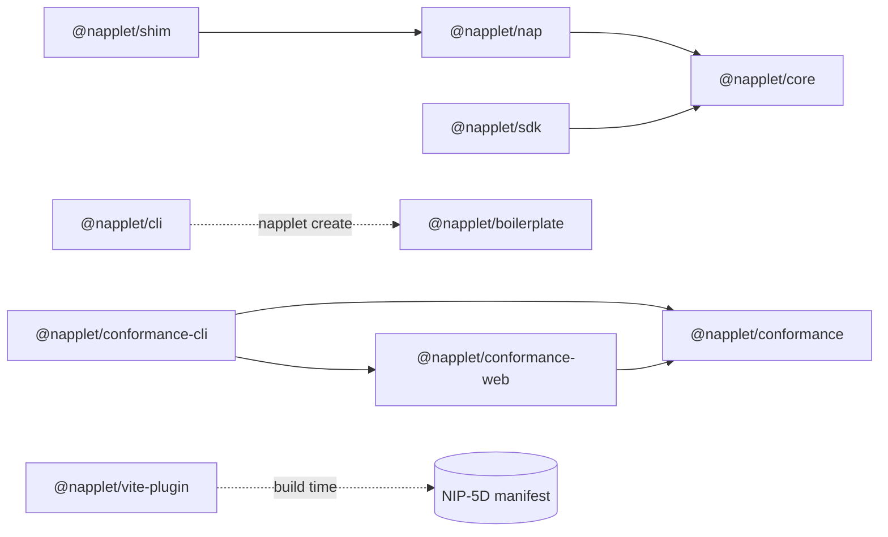

<div align="center">

# napplet

TypeScript SDK and tooling for NIP-5D napplets: sandboxed Nostr web apps that delegate signing, storage, and relay access to a host shell.

[](https://github.com/napplet/web/actions/workflows/ci.yml)
[](https://github.com/napplet/web/actions/workflows/conformance.yml)
[](https://github.com/napplet/web/actions/workflows/ai-slop.yml)
[](https://www.npmjs.com/package/@napplet/sdk)
[](LICENSE)
[](https://github.com/napplet/web/stargazers)

[Website](https://napplet.run) · [Docs](https://napplet.run/docs/) · [NIP-5D](https://github.com/nostr-protocol/nips/pull/2303) · [NAPs track](https://github.com/napplet/naps)

</div>

> [!WARNING]
> napplet is **alpha**. The specification is experimental and a moving target. There **will most certainly be drift** between packages and the specification. Things **will most certainly change**. **For adventurers only.**

## What is this?

A **napplet** is a small, single-purpose web app that runs inside a sandboxed iframe hosted by a **shell**. The napplet never touches `localStorage`, relay connections, or signing keys directly. The runtime hands the shell a `MessagePort` in a single `napplet.hello`, and every request after that is a JSON envelope (`{ type, ...payload }`) proxied through a NAP capability domain.

This monorepo holds the napplet-side packages, the build plugin, the CLI, the conformance tooling, the agent skills, and the [napplet.run](https://napplet.run) site. The protocol itself lives outside this repo: [NIP-5D](https://github.com/nostr-protocol/nips/pull/2303) defines the napplet ⇄ shell contract and the [NAPs track](https://github.com/napplet/naps) defines each capability domain. Everything here is non-normative and defers to those living documents.

## Quick start

Install the standalone CLI. Deno is not required:

```bash
# macOS or Linux
curl -fsSL https://napplet.run/install.sh | sh

# Windows PowerShell
irm https://napplet.run/install.ps1 | iex
```

Run `napplet --version` (also `-v` or `version`) to identify the installed CLI. Run `napplet guide` for the current workflow and links to the relevant docs, or follow the same path directly:

```bash
napplet create my-napplet
cd my-napplet
napplet init
npx skills add napplet/web     # agent skills via skills.sh (Claude Code, Codex, Cursor, …)
pnpm install
# Ask your agent to build the napplet, then verify and preview it.
pnpm verify
napplet deploy --dry-run
napplet deploy
```

`napplet create` downloads the maintained Vite + TypeScript starter. `napplet init` owns deployment name, title, description, archetype roles and conventions, relays, and Blossom servers in `.napplet/config.yaml`. The standalone CLI provisions its own cached tooling for screenshots, conformance, and Paja, so no host Node.js, npm, npx, Deno, Git, or Kehto installation is required. Node.js 20+ is needed by the generated Vite project and the optional skills.sh CLI.

`napplet deploy` captures a screenshot (also available as `napplet screenshot --output preview.png`) and publishes a separate Zapstore application event by default; use `--no-screenshot` and/or `--no-zapstore` to opt out. See the [CLI guide](packages/cli/README.md#screenshots-and-zapstore-metadata) for configuration, browser setup, and dry-run examples.

### Agent skills

`npx skills add napplet/web` installs the `napplet-*` skills from [`skills/`](skills). Two are worth calling out:

- [`napplet-icon`](skills/napplet-icon/SKILL.md) designs, generates, and refines an app icon, checks it at small sizes, and prepares it for NIP-5D integration: `npx skills add napplet/web --skill napplet-icon`.
- [`napplet-port-napp`](skills/napplet-port-napp/SKILL.md) ports an [eskema/nostrapps NAPP](https://github.com/eskema/nostrapps/blob/main/NAPP.md) through bridge replacement, implementation, and behavior verification: `npx skills add napplet/web --skill napplet-port-napp`.

The [agent skills guide](apps/docs/guide/agent-skills.md) covers the complete set and workflow.

## Packages

| Package | npm | JSR | Description |
|---------|-----|-----|-------------|
| [@napplet/core](packages/core) | [](https://www.npmjs.com/package/@napplet/core) | [](https://jsr.io/@napplet/core) | JSON envelope types (`NappletMessage`, `NapDomain`), NAP dispatch (`registerNap`, `dispatch`), protocol constants, and Nostr types. Imported by every other package. |
| [@napplet/shim](packages/shim) | [](https://www.npmjs.com/package/@napplet/shim) | [](https://jsr.io/@napplet/shim) | Runtime-side helper that injects selected `window.napplet.<domain>` objects before napplet code runs. |
| [@napplet/sdk](packages/sdk) | [](https://www.npmjs.com/package/@napplet/sdk) | [](https://jsr.io/@napplet/sdk) | Named TypeScript exports wrapping `window.napplet` for bundler consumers, with a domain wrapper and NAP message types per domain (`relay`, `storage`, `intent`, `navigation`, `llm`, …). |
| [@napplet/nap](packages/nap) | [](https://www.npmjs.com/package/@napplet/nap) | [](https://jsr.io/@napplet/nap) | One subpath per active NAP domain, each with barrel plus granular `types` / `shim` / `sdk` exports. Tree-shakable (`sideEffects: false`). See the [subpath reference](packages/nap/README.md). |
| [@napplet/vite-plugin](packages/vite-plugin) | [](https://www.npmjs.com/package/@napplet/vite-plugin) | [](https://jsr.io/@napplet/vite-plugin) | Builds current NIP-5D manifests: hashes the final `index.html` artifact, emits description content and capability/intent metadata, and defaults to single-file output. |
| [@napplet/cli](packages/cli) | [](https://www.npmjs.com/package/@napplet/cli) | [](https://jsr.io/@napplet/cli) | Standalone CLI for creating projects, owning deploy metadata, discovering builds, and deploying signed manifests. JSR/Deno remains an alternative install route. |
| [@napplet/boilerplate](packages/boilerplate) | [](https://www.npmjs.com/package/@napplet/boilerplate) | — | Project-only generator behind `napplet create`. Clones the maintained Vite + TypeScript starter without setting deployment metadata. |
| [@napplet/conformance](packages/conformance) | [](https://www.npmjs.com/package/@napplet/conformance) | [](https://jsr.io/@napplet/conformance) | Browser-safe conformance engine: envelope validators for the active NAP domains, a signed manifest-event validator, a reference mock shell, the zero-config check catalog, and pretty/JSON/JUnit reporters. |
| [@napplet/conformance-cli](packages/conformance-cli) | [](https://www.npmjs.com/package/@napplet/conformance-cli) | — | Headless `napplet-conformance` runner. Drives the engine against a napplet in real Chromium (Playwright) and sets a CI exit code. npm-only. |
| [@napplet/conformance-web](apps/conformance) | [](https://www.npmjs.com/package/@napplet/conformance-web) | — | Browser conformance runtime deployed at `/conformance` and bundled into `napplet-conformance --ui`, with a check tree, envelope log, and manifest inspector. |
| [@napplet/lab](packages/lab) | — | — | Private tooling for probing napplets and shells. Holds lab napplets under `packages/lab/napplets/*`, starting with the Security Lab, which probes the sandbox, CSP, namespace, runtime, and identity-revocation boundaries of whatever shell loads it. Published as NIP-5D manifests, not to npm. |

Release notes live in each package's `CHANGELOG.md`.

## Conformance testing

Napplets can check NAP protocol conformance **before** publishing, in two scopes that share one engine:

```bash
# Headless / CI: exits non-zero on any error-severity failure
npx napplet-conformance ./dist

# Live UI: opens the web runtime and re-runs on every change (like vitest --ui)
npx napplet-conformance --ui . --exec "vite build --watch"
```

```jsonc
// package.json (works with pnpm / npm / yarn / bun)
{
  "scripts": {
    "test:conformance": "napplet-conformance ./dist",
    "test:conformance:ui": "napplet-conformance --ui . --exec \"vite build --watch\""
  }
}
```

The same web runtime ships standalone at [napplet.run/conformance](https://napplet.run/conformance/). v1 is zero-config protocol conformance: signed manifest-event validity, boots under `sandbox="allow-scripts"`, receives a runtime-injected `window.napplet`, every emitted envelope is well-formed, graceful degradation when a domain is absent, and no forbidden globals.

## Architecture



At runtime the shell injects the domains it supports, then the napplet talks to it over one port:

```
Shell runtime                              Napplet (sandboxed iframe)
  ├── JSON envelope routing                  window.napplet.outbox   (query/subscribe/publish)
  ├── identity bound to the hello port       window.napplet.inc      (topics/channels)
  ├── ACL enforcement                        window.napplet.storage  (get/set/remove)
  ├── NAP dispatch (outbox/storage/…)        window.napplet.resource (bytes/bytesMany/…)
  └── INC routing                            absent domain = unavailable

◄────────── window: { type: 'napplet.hello' } + one MessagePort (once) ─────►
◄────────── port:   { type: 'outbox.subscribe', id, filters }       ─────────►
◄────────── port:   { type: 'outbox.event', subId, result }         ─────────►
```

The iframe uses `sandbox="allow-scripts"` without `allow-same-origin`, per the Transport section of [NIP-5D](https://github.com/nostr-protocol/nips/pull/2303). Napplets can't reach the shell's DOM, cookies, `localStorage`, or service workers; all persistent state goes through the shell's proxies.

### Event schema compatibility

Current event defaults begin at **CLI 0.7.0**, **Vite plugin 0.15.0**, **conformance 0.18.0**, and **conformance-cli 0.3.0**. Earlier release series use legacy path/aggregate manifests. The event kinds remain 5129/15129/35129; current events use the artifact SHA-256 in `x`, a description in `content`, and `R`/`O` plus `z`/`i` metadata. CLI deployments offer temporary `--format legacy` support; unattended deployments default to current. See the [migration guide](apps/docs/guide/event-migration.md) for event conversion, legacy pointers, and shell storage/ACL implications.

## NAP domains

Shells implement any subset of NAPs and inject only the domains they support, so feature-gate with `window.napplet?.<domain>` before use. Proposal status and our shipped implementation maturity are tracked separately, and every capability can change: inspect `NAP_IMPLEMENTATIONS` from `@napplet/core` and use `selectNapDomains` for local host opt-in policy. See [maturity and opt-in guidance](https://napplet.run/docs/naps/maturity.html) and the full [NAP domain reference](apps/docs/naps/index.md).

```ts
const result = await window.napplet.intent?.open('napplet:profile/open', {
  payload: { pubkey: 'abc123' },
  behavior: { focus: true, reuse: false },
});
if (!result?.ok) throw new Error(result?.error ?? 'intent not accepted');

window.napplet.intent?.onDelivery(({ sender, convention, payload }) => {
  console.log(sender, convention, payload);
});
```

Some domains with notable recent work (each guide is non-normative and defers to the linked proposal):

| Domain | What it does | Guide | Proposal |
|--------|--------------|-------|----------|
| `intent` | URI-based `invoke` / `open` dispatch. Acceptance transfers delivery to the runtime, which retains deliveries until `onDelivery` registers. | [intent](apps/docs/naps/intent.md) | [NAP-INTENT](https://github.com/napplet/naps/blob/master/naps/NAP-INTENT.md) |
| `shell` | Optional environment information; never gates other domains. | [shell](apps/docs/naps/shell.md) | [NAP-SHELL](https://github.com/napplet/naps/blob/master/naps/NAP-SHELL.md) |
| `navigation` | `report()` committed locations and `get()` runtime-owned history. Back/Forward arrives as an ordinary intent delivery. | [navigation](apps/docs/naps/navigation.md) | [draft](https://github.com/napplet/naps/pull/126) |
| `gamepad` | Cached controller snapshots, `available` / `focused`, and `onChange`. Keep keyboard or pointer controls as a fallback. | [gamepad](apps/docs/naps/gamepad.md) | [draft](https://github.com/napplet/naps/pull/108) |
| `llm` | User-selected model connections, stateless generations with optional napplet-executed tools, streamed deltas, and cancel. | [llm](apps/docs/naps/llm.md) | [draft](https://github.com/napplet/naps/pull/134) |
| `blossom` | Server-directed blob operations, BUD-03 server lists, and BUD-10 URI helpers. | [blossom](apps/docs/naps/blossom.md) | [draft](https://github.com/napplet/naps/pull/71) |
| `catalog` | Read-only, caller-scoped snapshot of runnable napplets via `catalog.get()`. | [catalog](apps/docs/naps/catalog.md) | [draft](https://github.com/napplet/naps/pull/95) |
| `torrent` | Runtime-owned download/seed jobs, verified reads, metadata export, and live settings. | [torrent](apps/docs/naps/torrent.md) | [draft](https://github.com/napplet/naps/blob/nap-torrent/naps/NAP-TORRENT.md) |
| `soulseek` | Network search, peer share browsing, paged result snapshots, and endpoint-owned downloads. | [soulseek](apps/docs/naps/soulseek.md) | [draft](https://github.com/napplet/naps/pull/135) |

## Project structure

```
apps/
├── conformance/     # standalone conformance web runtime (/conformance)
├── docs/            # VitePress documentation (/docs)
└── web/             # Astro showcase, protocol directory, explainer (/)
docs/                # internal design notes
edge/                # Bunny edge script for Markdown negotiation
packages/
├── boilerplate/     # generator behind `napplet create`
├── cli/             # standalone `napplet` CLI
├── conformance/     # conformance engine
├── conformance-cli/ # headless `napplet-conformance` runner
├── core/            # envelope types, dispatch, constants
├── lab/             # private probing tools and lab napplets
├── nap/             # per-domain NAP subpaths
├── sdk/             # named exports over window.napplet
├── shim/            # runtime-side domain installer
└── vite-plugin/     # NIP-5D manifest generation
scripts/             # repo tooling: site assembly, link checks, release sync
skills/              # napplet-* agent skills (skills.sh)
specs/               # shell resource policy notes
tests/               # e2e harness and fixture napplets
AGENTS.md            # contributor and agent rules (CLAUDE.md symlinks here)
```

## Documentation

| Resource | Description |
|----------|-------------|
| [Getting started](apps/docs/guide/getting-started.md) | Install the CLI and ship a first napplet |
| [Core concepts](apps/docs/guide/concepts.md) | Shells, napplets, domain presence, identity |
| [NIP-5D orientation](apps/docs/guide/nip-5d.md) | Non-normative tour of the protocol |
| [NAP domain reference](apps/docs/naps/index.md) | One page per domain with examples and maturity |
| [Agent skills](apps/docs/guide/agent-skills.md) | Building napplets with coding agents |
| [Event migration](apps/docs/guide/event-migration.md) | Moving from legacy manifests to current events |
| [Agent access](apps/docs/guide/agent-access.md) | Markdown copies, `llms.txt`, and the skills index on napplet.run |
| [Website development](apps/web/README.md) | Running and verifying the showcase site |

## Development

```bash
pnpm install
pnpm build          # build all packages via turborepo
pnpm type-check     # TypeScript validation
pnpm test:unit      # unit tests across the workspace
pnpm dev:site       # website + docs together on OS-chosen ports
```

`pnpm dev:site` prints both URLs and wires the website to its paired docs server, so concurrent launches can run side by side. To run one app on its own:

```bash
pnpm --filter @napplet/web dev             # showcase and explainer
pnpm --filter @napplet/docs dev            # documentation
pnpm --filter @napplet/conformance-web dev # conformance runtime
```

`pnpm generate:protocol` refreshes the `/protocol/` NAP directory and rebuilds the website; the deploy workflow also refreshes it daily. Docs dev prebundling uses the same `esnext` target as production builds, so keep `optimizeDeps.esbuildOptions.target` aligned with the other docs Vite targets when updating the toolchain.

`scripts/assemble-site.mjs` produces the static artifact used by link checks and `.github/workflows/deploy-site.yml`: showcase at `/`, original explainer at `/explainer/`, docs at `/docs/`, and conformance at `/conformance/`, plus Markdown copies of every page, `/llms.txt`, and the `/.well-known/agent-skills/` index. Bunny is the canonical deployment target, with `Accept: text/markdown` negotiation in the [`edge/`](edge/README.md) script; nsite is an optional mirror. Configure deploy secrets with `scripts/setup-site-secrets.sh`.

### Publishing

Publishing runs from GitHub Actions, never locally. Add changesets, run `pnpm version-packages` to bump versions and sync JSR metadata, and merge the release PR into `main`. npm publishing runs through Changesets. Every push to `main` also runs the JSR publisher, which skips versions already in the registry; manual dispatch can retry a failed release. The CLI is distributed through JSR and standalone GitHub release binaries.

## Contributing

Read [AGENTS.md](AGENTS.md) first. It covers protocol fidelity (never invent protocol surface; spec gaps go to the [NAPs track](https://github.com/napplet/naps)), branching, changesets, and what "done" means for a PR.

<a href="https://github.com/napplet/web/graphs/contributors">
  
</a>

## License

[MIT](LICENSE)

---

<div align="center">

[](https://star-history.com/#napplet/web&Date)

</div>
